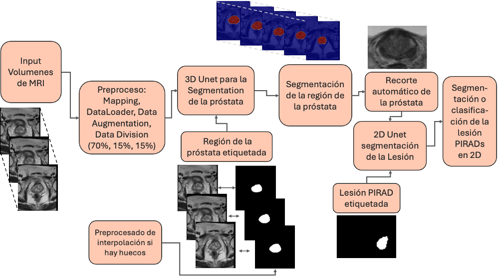
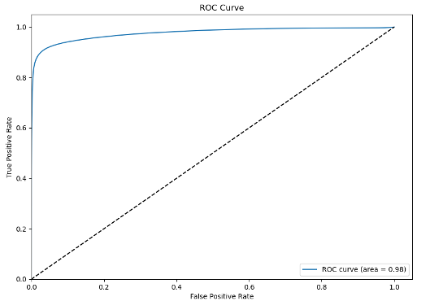
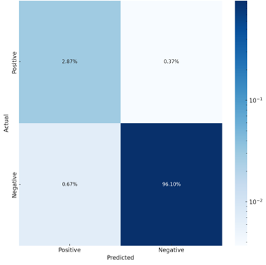

# 3D U-Net PIRAD Segmentación

## Descripción General

Se busca desarrollar un sistema que, a partir de imágenes multiparamétricas de Resonancia Magnética (RM) de próstata, clasifique las lesiones según el estándar internacional PIRAD, estimando el riesgo de cáncer de próstata (CaP). El objetivo es reproducir el criterio diagnóstico de un radiólogo experto para reducir la carga de trabajo y disminuir el número de biopsias innecesarias, especialmente en aquellos casos en que la RM determina que no hay riesgo significativo de CaP. De este modo, se espera alcanzar niveles de precisión, sensibilidad y especificidad que permitan apoyar el diagnóstico con garantías. Una vez entrenado, el sistema ofrecerá una clasificación automatizada tanto de la próstata como de la puntuación PIRAD para cada paciente, agilizando la identificación de lesiones potencialmente malignas y sirviendo de soporte en la toma de decisiones clínicas.

## Características

- Arquitectura 3D U-Net para la segmentación automática de los volúmenes de la próstata.
- Preprocesamiento de la base de datos.
- Pipeline completo de segmentación.
- Scripts para entrenamiento y evaluación.




## Requisitos

- **Python** 3.8 o superior
- **Framework de aprendizaje profundo:** PyTorch (y SemTorch para la segmentación y clasificación 2D)
- **Librerías necesarias:**  `requirements.txt`

## Configuración

1. **Clonar el repositorio:**

   ```bash
   git clone https://github.com/marinadominguez/Prostate-PIRAD-Segmentation.git
   ```

2. **Instalar dependencias:**

   ```bash
   pip install -r requirements.txt
   ```

3. **Gestión de datos y estructura de carpetas:**

   - Coloca la ruta de tu dataset en `BASE_PATH` dentro del archivo de configuración `config.py` (por razones de privacidad, los datos no están incluidos en el repositorio).
   - Para los recortes de la región de interés de la próstata, crea una carpeta `data` donde se guarden las imágenes recortadas para hacer la segmentación en 2D.
   - Además, las imágenes generadas y las tablas de Excel con resultados se almacenan en `output`, mientras que los modelos entrenados se guardan en `checkpoints`.

## Preprocesamiento de Datos de RMN Prostática

Dentro de estos scripts se encuentran las rutas que deben ser configuradas. Además, los outputs generados por cada uno son necesarios para el siguiente paso, funcionando como una cascada. Es crucial ejecutar cada etapa en orden para asegurar un correcto preprocesamiento de los datos.

1. **Filtrado y Extracción:**

   ```bash
   python 01_filter_and_extract_annotations.py
   ```

2. **Preprocesamiento de Anotaciones:** 

   Depende de la estrategia que se quiera seguir para procesar los datos:

   - Mantener las cuatro etiquetas originales:
     ```bash
     python 02_preprocess_all_annotations.py
     ```

   - Procesar solo una etiqueta específica (próstata, PIRAD3, PIRAD4 o PIRAD5):
     ```bash
     python 02_preprocess_one_annotation.py
     ```

   - Combinar múltiples etiquetas en una sola (por ejemplo, fusionar PIRADS 4 y 5 como 'cáncer'):
     ```bash
     python 02_preprocess_multiple_annotations_as_one.py --annotations PIRAD4 PIRAD5 --output-label cancer
     ```

3. **Resúmenes de Anotaciones:**

   ```bash
   python 03_annotated_slices_per_patient.py
   ```

4. **Interpolación y Finalización:**

   ```bash
   python 04_interpolate_and_finalize_annotations.py
   ```

5. **(Opcional) Recorte:**

   ```bash
   python cropping_imgs_prostates&lessions/05_preprocess_cropping.py
   ```

## Entrenamiento del Modelo

1. **Ajustar Configuración:**
   - Edita `config/config.py` con los parámetros que corresponda.

2. **Ejecutar el Script de Entrenamiento:**

   ```bash
   python trainandval_wtrans_sigmoid.py
   ```

3. **Fine-Tuning:** Carga pesos pre-entrenados y ejecuta el script:

   ```bash
   python fine_tuning.py
   ```

## Evaluación del Modelo

1. **Encontrar el Umbral Óptimo:**

   ```bash
   python evaluation/find_th_prostate_testing_sigmoid.py
   ```

2. **Evaluación con Umbral Definido:**

   ```bash
   python evaluation/testing_metrics_for_table_sigmoid.py --selected_threshold 0.202
   ```

3. **Cálculo de Volúmenes:**

   ```bash
   python evaluation/compute_prostate_volume.py --selected_threshold 0.202
   ```

4. **Ejecución Automatizada:**

   ```bash
   bash run_evaluation.sh
   ```
<p align="center">
  
  
</p>

## Postprocesamiento

### Extracción de la Mayor Componente Conexa:

   ```bash
   python postprocessing/compconexamayor_sigmoid.py
   ```

## Evaluación de Lesiones (2D)

Mientras no se disponga de datos 3D suficientes para lesiones, se ha incluido el siguiente notebook:

**Notebook:** `Segmentation_Lesion_2D_UNet.py`

## Futuras Extensiones

Actualmente, el pipeline se centra en la segmentación prostática. Sin embargo, está previsto entrenar la misma arquitectura (UNet3D) para la detección y segmentación de lesiones. Una vez que se disponga de más datos anotados para lesiones, podrás:

1. **Entrenar el Modelo 3D para Lesiones:**
   Podrás seguir el mismo flujo de entrenamiento mostrado para la próstata, pero aplicándolo los recortes de la próstatas obtenidos gracias a esta red ya entrenada y utilizando las etiquetas de las lesiones. El script y los pasos son similares; se puede encontrar el script de entrenamiento en:
   ```bash
   python future_work/trainandval_wtrans_wcropping.py
   ```

3. **Evaluar el Modelo de Lesiones:**
   Está disponible el script 
   ```bash
   python future_work/find_th_cancer_testing.py
   ```
   , que permite:

- Aplicar el modelo al conjunto de prueba con lesiones.
- Probar múltiples umbrales de probabilidad.
- Calcular métricas (TPR, TNR, PPV, NPV, IoU, AUC) y encontrar el umbral óptimo para las lesiones, siguiendo la misma lógica usada para la próstata.

Así podrás evaluar el desempeño del modelo en la identificación de lesiones una vez que se tenga el conjunto de datos adecuado.
